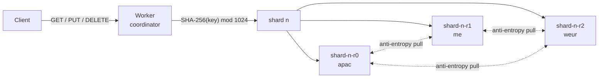
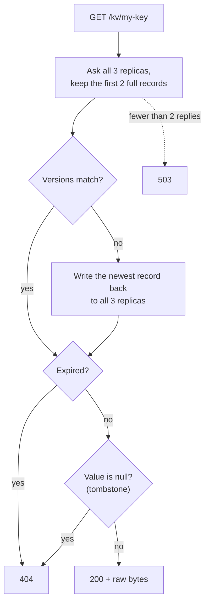
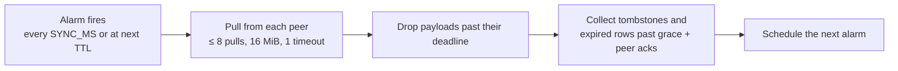

# quorum-kv

A small binary key-value store where two of three replicas is always enough to read or write —
no leader, no compare-and-swap, no extra coordination service.

quorum-kv is a prototype. Each key lives in exactly one shard, and each shard is three
SQLite-backed Durable Objects, so the data is ordinary SQL until you ask it for quorum
semantics. The consistency model is an ABD multi-writer register: every replica can accept a
write, and version numbers let anyone figure out which write won.

The trade-off is deliberate. You get read and write availability while one replica is down or
slow, and you pay for it with two round trips per write, no local-read lease, and a per-key
throughput ceiling of roughly one Durable Object.

## How the pieces fit together

A SHA-256 hash of the key picks one of 1024 fixed shards. Replica names follow the pattern
`shard-<n>-r<i>`, and each replica can derive its siblings from its own name. The current
runtime preserves `ctx.id.name` for named RPCs and alarms.



The default placement hints are `apac`, `me`, and `weur`. They are only hints: they apply when
an object is first located and do not guarantee that the three replicas live in separate
regions. You can change them, but don't change the shard count, hash, replica names, or hint
ordering of an existing deployment without a migration.

## Request flows

### Writing a value

A write is two quorum phases. First the coordinator asks all three replicas for their current
version and waits for two answers. Then it computes a new version, sends it to all three, and
waits for two acknowledgments.

```mermaid
sequenceDiagram
    autonumber
    participant C as Client
    participant W as Coordinator
    participant R0 as r0
    participant R1 as r1
    participant R2 as r2

    C->>W: PUT /kv/my-key
    W->>R0: readVersion
    W->>R1: readVersion
    W->>R2: readVersion
    Note over W: keep the first 2 replies
    R0-->>W: counter
    R1-->>W: counter
    Note over W: counter = max(now, highest seen + 1)<br/>writer = random UUID
    W->>R0: write(record)
    W->>R1: write(record)
    W->>R2: write(record)
    Note over W: keep the first 2 acks
    R0-->>W: ok
    R2-->>W: ok
    W-->>C: 204
    Note over R1: the third request keeps<br/>running in the background
```



The version counter is wall-clock milliseconds, but always at least one above the highest
counter observed. A random writer ID breaks ties within the same millisecond. Deletes use the
same path with a null tombstone as the value.

If two of the three replicas don't answer within the phase timeout, the request fails with
HTTP 503. Requests that were already dispatched are not cancelled — they finish in the
background, which is why a timed-out write can still commit.

### Reading a value

A read is usually one quorum round. If the two replies disagree on the version, the coordinator
repairs the lagging replicas first, then answers.



Repairs reuse the version from the read instead of minting a new one, and they carry the
read's _start_ time. That stamp matters: a stalled read can't come back later and pass old data
off as fresh.

Reads also hide expired records, including when only a timeout expired them. Expiration on its
own never generates a write, but a read still repairs if the two replies disagree.

### What a request costs

| Operation              | DO RPCs | Quorum round trips                 |
| ---------------------- | ------- | ---------------------------------- |
| Normal read            | 3       | ~1 (to the second-fastest replica) |
| Write / delete         | 6       | 2                                  |
| Read that needs repair | 6       | 2                                  |

Those counts exclude the Worker entry point, object startup, storage work, alarms, and queueing.
There is no local-read lease, and because every key is pinned to a single three-replica shard,
per-key throughput is bounded by one Durable Object rather than scaling with the shard count.

## HTTP API

| Method   | Path                   | Success          | Notes                                          |
| -------- | ---------------------- | ---------------- | ---------------------------------------------- |
| `GET`    | `/kv/:key`             | `200`, raw bytes | `404` when absent, deleted, or expired         |
| `PUT`    | `/kv/:key?ttl=seconds` | `204`            | Raw binary body; positive fractional TTLs work |
| `DELETE` | `/kv/:key`             | `204`            | Also succeeds when the key is already absent   |

Keys are URL-encoded UTF-8 and capped at 1024 bytes. Values default to a 1 MiB limit and can be
raised with `MAX_VALUE_BYTES`. A body over the limit returns `413`; `QuorumKV.put` throws a
`RangeError` before any replica RPC happens. The HTTP layer counts streamed bytes rather than
trusting `Content-Length`.

The default value limit leaves room for key and version metadata under the
[8 MB SQLite row limit](https://developers.cloudflare.com/durable-objects/platform/limits/index.md).
If you raise it, leave that overhead in place. An empty value is a real value and is distinct
from a missing key.

Other responses: `400` for an invalid key encoding, bad key length, or invalid TTL, `405` for
unsupported methods, and `503` when no quorum is available.

## Seeing what happened

Send `X-KV-Debug: 1` and the response includes `X-KV-Quorum`: JSON listing the replicas that
answered and the latency of each phase. It is the quickest way to confirm which two replicas
made a request succeed.

## Configuration

All of these are Worker environment bindings. Defaults live in `src/config.ts`, and overriding
them in the Alchemy Worker environment keeps local and deployed behavior in sync.

| Binding              | Default            | What it controls                                               |
| -------------------- | ------------------ | -------------------------------------------------------------- |
| `SHARDS`             | `1024`             | Number of key shards                                           |
| `LOCATION_HINTS`     | `apac,me,weur`     | Three distinct placement hints, in replica order               |
| `REPLICA_TIMEOUT_MS` | `1500`             | Per-phase, per-replica timeout; also the shared sync deadline  |
| `GC_GRACE_MS`        | `86400000` (1 day) | Minimum age before a tombstone or expired row can be collected |
| `SYNC_MS`            | `30000`            | Anti-entropy period, and how often the cleanup alarm runs      |
| `SYNC_BATCH`         | `256`              | Rows per sync pull                                             |
| `MAX_VALUE_BYTES`    | `1048576` (1 MiB)  | Largest accepted value                                         |

## Expiration and garbage collection

TTL deadlines travel with each versioned record, so every replica can hide expired data on its
own. Expiring a value does not write anything; the row keeps its version metadata and simply
loses its payload. A partial expiration index handles both deadline scheduling and payload
cleanup without scanning non-TTL rows, and a partial `gc_at` index keeps collection off a full
table scan.

Payloads are cleared at their deadline or at the next periodic alarm, whichever comes first.
Tombstone collection rides the same `SYNC_MS` alarm, so a larger `SYNC_MS` delays both.

Rows are only physically deleted after the GC grace period _and_ acknowledgment from both peers
that they have seen the row's local sequence. Duplicate writes don't extend tombstone grace. A
peer that is down forever blocks collection for the rows it hasn't acknowledged; replacing or
wiping a replica needs a rebuild protocol that doesn't exist yet.

## Background sync (anti-entropy)

Each replica pulls changed rows from its two siblings every `SYNC_MS` (30 seconds by default),
including right after a write. Clients never have to trigger this.

A pull returns at most `SYNC_BATCH` rows, assembled incrementally under a 4 MiB budget that
accounts for payload copies, strings, and metadata — headroom for RPC serialization and for
pulls running against both peers at once. Each peer's sync stops after eight pulls, 16 MiB of
budgeted bytes, or one shared `REPLICA_TIMEOUT_MS` deadline, whichever comes first. A final
batch may exceed the byte quota, and a single row bigger than the budget is returned alone so
recovery still advances; its size is bounded by the SQLite row limit.

Every applied version gets a monotonically increasing durable local sequence number. Applying
a batch and advancing its cursor happen atomically, and the next pull acknowledges the
previously applied batch. If a pull fails or times out, that batch stays unapplied, while
earlier completed batches keep their durable progress for later alarms.

Those per-alarm quotas bound backlog work so cleanup and rescheduling can continue, but
sustained writes can still outrun anti-entropy. Shards that have been touched keep scheduling
periodic alarms even when empty, so a stale peer can catch up without any client traffic.



## What the consistency guarantee actually covers

The register is linearizable as long as you keep these assumptions:

- Replicas are durable, quorums intersect, and versions are retained.
- Clocks are roughly synchronized and end-to-end operation plus sync delays are bounded.
- The GC grace is much larger than replica timeouts and those bounds.

Versions are wall-clock milliseconds bumped above anything already seen, so an earlier partial
write can't outrank a later completed one — except within clock skew or within the same clock
tick. Coordinator writes and repairs stamp `writtenAt` when the operation starts, and replicas
reject a direct write older than their GC grace, even after GC. Repairs carry the read's start
time and never mint a new version. Rows applied by sync skip the age check because they already
live on a durable replica.

The main thing to watch is that an old read result must never be re-stamped by a repair after
the grace period has passed. A coordinator timeout doesn't cancel an RPC that already left, so
arbitrarily stalled operations, unbounded clock skew, or replica data loss are outside the
guarantee. There is also no permanent per-key deletion watermark.

And the usual small-store caveats: no multi-key transactions, snapshots, list operations, or
exactly-once writes. A timed-out write can still commit, and concurrent writes pick a single
winner rather than preserving every value. Requests tolerate crash faults, not Byzantine ones.

TTL is wall-clock based too, so clock skew between Workers and replicas can move the visibility
boundary around an expiration.

## Development

```sh
npm ci
npm run check        # TypeScript, Oxlint, Oxfmt check, and the Vitest suite
npm run format       # apply Oxfmt
```

`npm run check` runs the real thing: `@alchemy.run/test/Vitest` deploys the Alchemy stack once
per suite in local mode, drives actual workerd SQLite Durable Objects over HTTP, and tears the
stack down afterward. A second stack without test bindings verifies that the debug routes
return 404. Fixtures use distinct shards, and coordinator tests use HTTP-backed replica
adapters.

### The test-only debug bridge

The test stack sets `TESTING=true` and `SYNC_BATCH=4`. Only that binding enables
`POST /_debug/replica/:name`, a fixed-command bridge for replica reads, writes, faults, alarm
delivery, row and cursor inspection, pulls, expiration query plans, deadline aging, and eviction
after a durable storage sync. There is also `POST /_debug/request`, which runs the HTTP handler
with per-request timeout and value-limit overrides and can reconstruct streamed bodies —
including deliberately false `Content-Length` values that HTTP clients won't send on the wire.

Production configuration omits `TESTING` entirely, and both the HTTP bridge and its Durable
Object RPC reject anything other than the exact string `"true"`.

### Running tests against the real thing

`ALCHEMY_TEST_DEV=0 npm test` runs the same suite live against a configured Cloudflare
profile; `ALCHEMY_TEST_DEV=1` forces local mode. The harness defaults to `dev: true` and reads
URLs from stack outputs instead of assuming localhost. Live runs deploy a throwaway
`TESTING`-enabled stage plus a guard stage, then destroy both. Stage names are random unless
`ALCHEMY_TEST_STAGE` is set, and any stage you pass explicitly must still be disposable.

Never point a test run at an existing deployment, and never expose a `TESTING`-enabled stage to
untrusted callers. Tight latency assertions also want a test runner physically near the
deployed Worker.

## Running and deploying

`npm run dev` starts Alchemy local development at <http://localhost:31463>; override the port
with `PORT`. Alchemy keeps deployment state in the Cloudflare state store, so both local
development and `npm run deploy` need a configured Cloudflare profile. On first use,
`Cloudflare.state()` deploys or adopts the account-level `alchemy-state-store` Worker.
Deployment is not part of the local test suite.

## Please don't ship this as-is

The HTTP endpoint has no authentication. Keep it local, or put access control in front of it
before exposing a deployment.

The local tests exercise failure and ordering behavior — not real regional placement, network
partitions, clock synchronization, or production latency.
